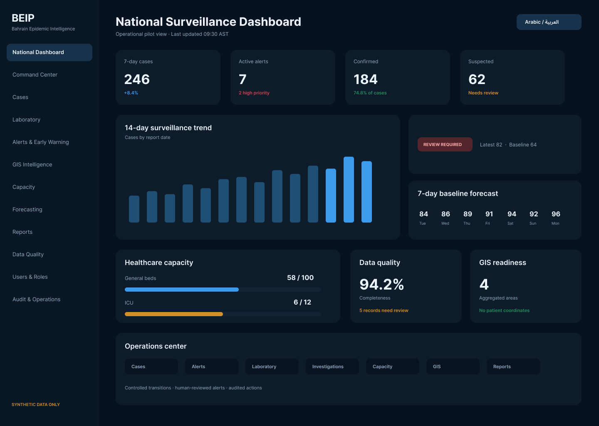
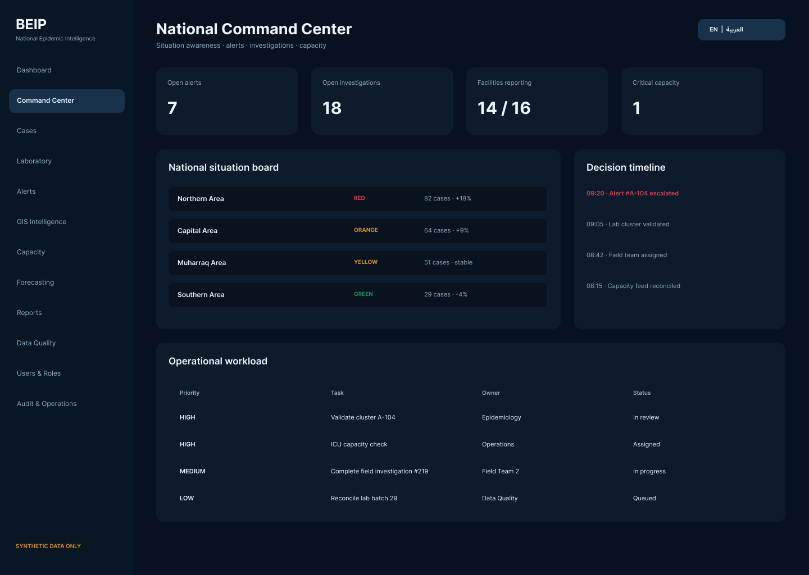
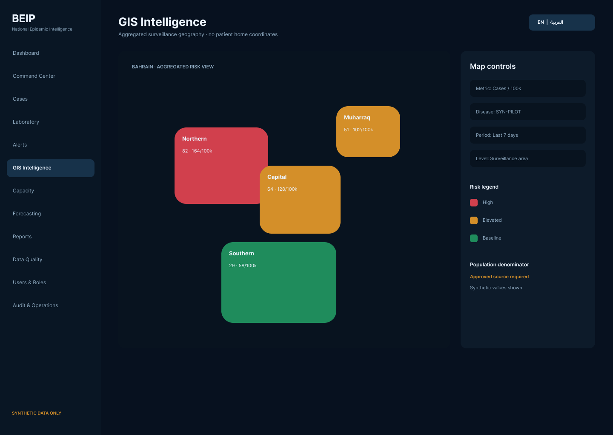
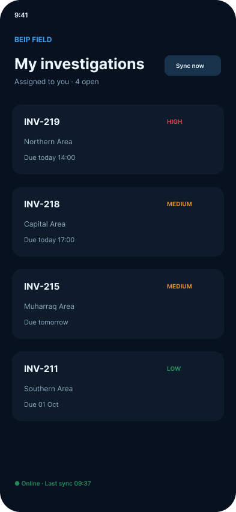
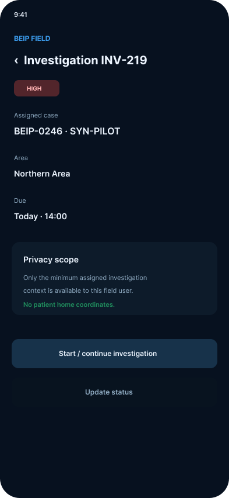
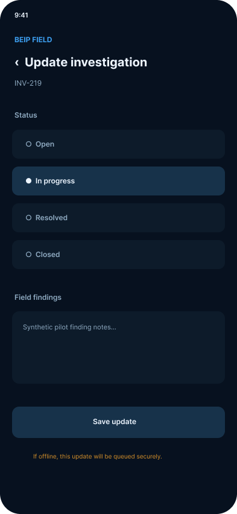
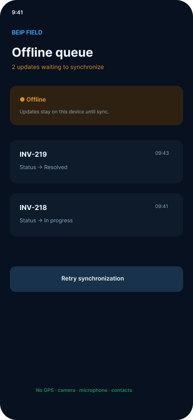
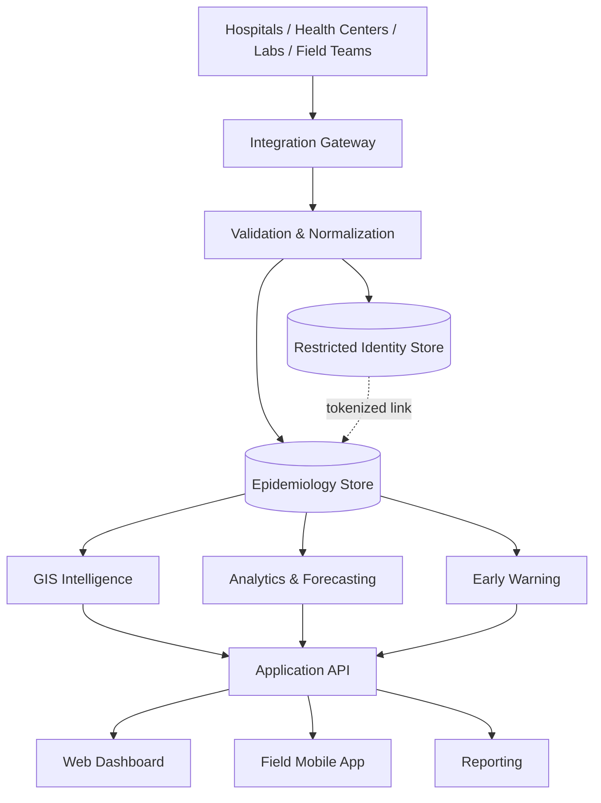

# Bahrain Epidemic Intelligence Platform (BEIP)

**Public project overview and UI showcase**

BEIP is a prototype epidemiological intelligence platform designed to demonstrate how authorized public-health teams could combine surveillance, early-warning, geospatial intelligence, forecasting, laboratory information and field investigation workflows in one controlled environment.

> **Public showcase repository:** This repository intentionally contains no application source code, credentials, production configuration, database contents, confidential operational documentation, or identifiable health information. The implementation source is maintained separately in a private repository.

## Project status

**v0.2.0-rc2 pilot release candidate / prototype.** The project is intended for controlled technical demonstration and UAT using synthetic/de-identified data. It does not represent authorization to process identifiable health information or an approved Government of Bahrain production system.

## Capabilities demonstrated

- National and disease-specific surveillance dashboards
- Epidemiological command-center workflows
- Case and laboratory surveillance concepts
- Early-warning and human-reviewed alert workflows
- GIS / spatial intelligence
- Short-term forecasting and healthcare-capacity intelligence
- Field-investigation mobile workflows
- Arabic/English user experience
- Role-based access and audit-oriented design
- Reporting and data-quality workflows

## UI preview

### National surveillance dashboard

### National command center

### GIS intelligence

### Field investigation mobile workflow

  
  
  
  

All values visible in these screenshots are synthetic/de-identified demonstration data.

## Conceptual architecture

## Technology overview

| Layer | Technology |
|---|---|
| Backend | Python, Django, Django REST Framework |
| Async processing | Celery, Redis |
| Web | React, TypeScript, Next.js |
| Mobile | Flutter |
| Database / GIS | PostgreSQL, PostGIS |
| Analytics | Python data-science ecosystem |
| Mapping | MapLibre GL / Leaflet |
| Integration | REST/OpenAPI and healthcare interoperability concepts |
| Runtime | Containerized deployment |

## Repository boundary

This public repository is deliberately limited to non-confidential project information and selected demonstration assets. It does **not** contain:

- Backend, frontend or mobile application source code
- Deployment or infrastructure configuration
- Environment files, secrets, keys or credentials
- Database dumps, backups or production data
- Internal security controls or operational runbooks
- Confidential integration details
- Identifiable patient or health information

## Safety and governance

BEIP's analytics and AI concepts are intended as decision-support capabilities. They are not intended to autonomously diagnose patients, declare outbreaks, or issue public-health instructions. Any real-world deployment would require the applicable legal, privacy, cybersecurity, clinical/public-health, data-owner and infrastructure approvals.

## About this repository

This repository exists to provide a public overview of the BEIP project, its design direction and selected prototype user interfaces while keeping the implementation and operational material private.
